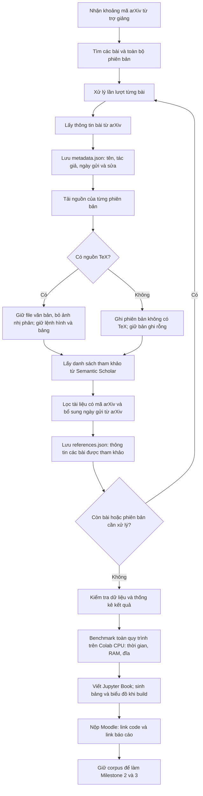

# Kế hoạch Milestone 1 — Thu thập dữ liệu bài báo arXiv

Ngày lập: 11/10/2026. Tổng hợp từ đề bài và cuộc trao đổi về cách làm bằng Jupyter Notebook.

> Đây là kế hoạch tổng quan. Khi triển khai, đọc [phân công cập nhật](./PHAN_CONG_MILESTONE_1_4_NGUOI.md), nhất là mục 11–17, và schema/prototype hiện tại trong src/crawling. Nhóm đã chốt requests + XML Atom cho discovery, một notebook chung và bốn người Khánh/Khang/Nguyên/Danh; các ví dụ hoặc lựa chọn cũ dưới đây không thay giao diện đã chốt.

**Mục tiêu:** viết chương trình Python tự động thu thập các bài arXiv được giao, đủ mọi phiên bản, kèm thông tin bài và tài liệu tham khảo; tổ chức thành kho dữ liệu và báo cáo kết quả.

**Cách triển khai đề xuất:** dùng Jupyter Notebook để điều khiển, xem kết quả và phân tích; đưa các hàm tái sử dụng vào file Python. Báo cáo Milestone 1 và 2 dùng chung một Jupyter Book ở repository riêng.

**Công cụ:** Python, Jupyter Notebook, requests, pathlib, json, tarfile/gzip, pandas, matplotlib, psutil; chọn arXiv API làm cách tìm bài ban đầu. Thư viện arxiv có thể hỗ trợ truy vấn. Các tên thư viện và cách chia file dưới đây là đề xuất, không phải danh sách bắt buộc của thầy.

**Đề đối chiếu:** [ARXIV_PROJECT_FULL.md](../../ARXIV_PROJECT_FULL.md), phần Milestone 1. Trang gốc: https://hcmus-cs-ta.github.io/lab-book/intro-ds/statement/crawling/

## 1. Hiểu đúng việc đang làm

Hãy hình dung mỗi bài báo là một tập hồ sơ. Nhóm cần tự động tạo hồ sơ gồm:

| Thành phần | Hiểu dễ hiểu | Dùng tiếp để làm gì? |
|---|---|---|
| Nguồn từng phiên bản | Các file văn bản dùng để tạo bài báo | Milestone 2 tách nội dung và chuẩn hóa |
| metadata.json | Phiếu thông tin của chính bài đang thu thập | Quản lý, thống kê, xuất dataset cuối |
| references.json | Phiếu thông tin các bài mà bài hiện tại tham khảo | Milestone 3 đối chiếu với tham khảo trích từ nguồn |
| Nhật ký và số đo | Ghi lại kết quả thu thập và tài nguyên sử dụng | Báo cáo, kiểm tra thiếu dữ liệu, chạy tiếp khi lỗi |

Luồng công việc:

```text
Khoảng mã bài trợ giảng giao
    → tìm bài và các phiên bản
    → tải nguồn, giữ văn bản
    → lấy metadata bài và metadata tham khảo
    → lưu kho dữ liệu theo bài/phiên bản
    → kiểm tra, thống kê, benchmark
    → viết Jupyter Book và nộp link
```

Chặng này chưa cần huấn luyện mô hình, chưa cần tách cây nội dung hoặc gộp tài liệu tham khảo trùng giữa các phiên bản.

### Sơ đồ quy trình Milestone 1



**Đọc sơ đồ:** mỗi bài có một phiếu thông tin `metadata.json`, nguồn riêng cho từng phiên bản và một danh sách thông tin tham khảo `references.json`. Lặp lại việc đó cho phạm vi được giao, rồi kiểm tra, đo hiệu năng và báo cáo. Nhật ký và số đo được ghi trong lúc chạy; benchmark là lần đo toàn quy trình trên Colab, không chỉ đo bước tổng hợp cuối. Lỗi mạng/API cần được ghi nhận và thử lại có giới hạn, không coi là trường hợp không có TeX hay không có tham khảo. Nếu còn lỗi chưa khắc phục, báo cáo rõ dữ liệu thiếu.

## 2. Những điểm đã thống nhất và những điều đề chưa nói

- Phạm vi bài chính thức là khoảng mã arXiv do trợ giảng cung cấp. Link đề hiện chưa chỉ ra khoảng mã cụ thể của nhóm.
- BERT và RoBERTa chỉ là hai bài tự chọn để minh họa kỹ thuật.
- Kaggle chứa metadata có thể giúp tìm/lọc bài; nó không thay cho việc tải nguồn LaTeX và lấy metadata tham khảo.
- arXiv API, OAI-PMH và Kaggle là những phương án được đề giới thiệu, không phải ba cách đều bắt buộc triển khai.
- Đề cho phép source `.py` hoặc `.ipynb`; hướng của nhóm là notebook kết hợp module Python.
- Jupyter Notebook là nơi chạy code theo ô. Jupyter Book là công cụ biên dịch notebook và nội dung giải thích thành website báo cáo.
- Tên thư mục/file đề gợi ý có thể điều chỉnh, nhưng dữ liệu vẫn phải đầy đủ và dùng được cho chặng sau.
- Việc dùng dataset bên ngoài để huấn luyện thuộc Milestone 3. Đề không ghi cấm toàn bộ dataset ngoài; cũng chưa nói rõ được thay dữ liệu tự tạo bằng dataset ngoài. Không suy diễn thành một lệnh cấm trong kế hoạch này.

## 3. Các yêu cầu cần giữ xuyên suốt

- Thu thập bằng chương trình trên phạm vi được giao, lấy tất cả phiên bản của từng bài.
- Giữ nguồn văn bản gốc; đề khuyên bỏ ảnh nhị phân để giảm dung lượng nhưng giữ các lệnh hình/bảng trong LaTeX.
- Phiên bản không có TeX phải được ghi nhận bằng bản ghi rỗng, không làm mất bài khỏi danh sách.
- Lấy metadata tài liệu tham khảo qua Semantic Scholar cho mỗi bài. Không mặc định dịch vụ phân biệt được tham khảo của từng phiên bản.
- Code công khai trong một repository dùng xuyên suốt các milestone; lưu lịch sử cập nhật.
- Báo cáo công khai trong repository Jupyter Book riêng, đưa lên GitHub Pages.
- Bảng/biểu đồ của báo cáo được tạo khi biên dịch sách.
- Benchmark cuối trên Google Colab CPU; không đặt giới hạn thời gian theo đề, nhưng phải nằm trong dung lượng đĩa Colab.
- Milestone 1 chưa nộp corpus. Giữ lại để làm Milestone 2–3 và xuất Hugging Face ở cuối.
- Nộp Moodle theo nhóm, đúng ngôn ngữ chính thức của chương trình học; không được nộp trễ. Dùng tài liệu ngoài phải trích dẫn, code phải có giải thích rõ.

## 4. Sẽ dùng Jupyter như thế nào?

Notebook sẽ là bảng điều khiển, chia thành các ô theo trình tự:

1. Giải thích mục tiêu và phạm vi đang chạy.
2. Nạp thư viện, cấu hình và đường dẫn dữ liệu.
3. Tìm bài, hiển thị bảng bài và phiên bản.
4. Gọi hàm tải nguồn.
5. Gọi hàm lấy metadata và tham khảo.
6. Kiểm tra dữ liệu, xem lỗi.
7. Tổng hợp thống kê và vẽ biểu đồ.

Các hàm dài như tải gói nguồn, gọi API hoặc đo tài nguyên nằm trong `.py`, notebook gọi lại. Cách này giúp chạy lại từng bước và tái sử dụng code ở milestone sau.

Không đặt tất cả tác vụ cào vào quá trình biên dịch báo cáo: chạy cào riêng, lưu dữ liệu/kết quả đo; notebook báo cáo đọc những kết quả đó để tính bảng và biểu đồ khi build sách.

## 5. Cấu trúc dự kiến

Trong repository code:

```text
src/
├── crawling/
│   ├── __init__.py
│   ├── discover.py       # Tìm bài, metadata và phiên bản
│   ├── download.py       # Tải, nhận diện và xử lý nguồn
│   ├── references.py     # Semantic Scholar, bổ sung metadata tham khảo
│   ├── pipeline.py       # Điều phối, trạng thái, chạy tiếp
│   └── metrics.py        # Thống kê, thời gian, RAM, dung lượng
├── notebooks/
│   └── milestone1.ipynb  # Chạy quy trình và kiểm tra kết quả
└── requirements.txt
README.md
.gitignore
```

Trên máy hoặc Colab, ngoài phần code được đưa lên GitHub:

```text
data/
├── manifest.json        # Danh sách bài/phiên bản và trạng thái
├── 1810-04805/
│   ├── metadata.json
│   ├── references.json
│   └── sources/
│       ├── v1/
│       └── v2/
└── 1907-11692/
    ├── metadata.json
    ├── references.json
    └── sources/v1/
logs/
metrics/
```

Hai mã bài trên chỉ minh họa cấu trúc. Không commit corpus, gói tải, log, khóa API hoặc output notebook chứa dữ liệu cào hàng loạt vào repository code. Notebook code vẫn được giữ, nhưng làm sạch output trước khi commit nếu chứa dữ liệu đó. Repository báo cáo riêng có cấu hình sách và nội dung báo cáo.

## 6. Kế hoạch thực hiện từng việc

### Việc 1 — Chốt đầu vào và chuẩn bị môi trường

**Làm gì:** lấy khoảng mã chính thức từ Moodle/trợ giảng; tạo môi trường Python và notebook.

**Làm bằng gì:** Python, Jupyter, pip; Colab cho benchmark cuối.

**Làm thế nào:**

- [ ] Ghi lại phạm vi được giao và nguồn thông báo, tránh tự đoán bài phải làm.
- [ ] Tạo notebook theo các ô ở mục 4.
- [ ] Cài các thư viện cần dùng, ghi phiên bản đã chạy thành công vào requirements.txt.
- [ ] Đặt đường dẫn corpus và cấu hình phạm vi ở đầu notebook.
- [ ] Nếu có Semantic Scholar API key, đọc từ biến môi trường hoặc Colab Secrets, không ghi vào code/notebook.

**Đầu ra:** notebook mở được; import thư viện thành công; cấu hình phạm vi rõ ràng. Nếu chưa có phạm vi chính thức, chỉ chạy thử bằng danh sách bài minh họa và ghi đúng nhãn thử nghiệm.

### Việc 2 — Tìm bài và xác định mọi phiên bản

**Làm gì:** chuyển khoảng mã thành danh sách bài tồn tại, metadata và các phiên bản cần tải.

**Làm bằng gì:** arXiv API; có thể dùng thư viện arxiv để đọc kết quả. Chọn một đường tìm bài trước, chỉ bổ sung Kaggle/OAI-PMH khi cần.

**Làm thế nào:**

- [ ] Truy vấn đúng phạm vi; xử lý phân trang nếu kết quả nhiều.
- [ ] Lưu mã bài gốc và danh sách phiên bản đã xác minh. Không lấy ngày sửa mới nhất làm toàn bộ lịch sử phiên bản.
- [ ] Tạo manifest ghi từng bài/phiên bản đang chờ, đã thành công, không có TeX hay lỗi tải.
- [ ] Phân biệt mã bài chuẩn với tên thư mục: `1810.04805` là mã gốc, `1810-04805` là tên lưu theo gợi ý. Mã kiểu cũ như `hep-th/9901001` cần ánh xạ tên thư mục an toàn nhưng giữ nguyên mã gốc trong dữ liệu.

**Đầu ra:** bảng danh sách bài và các phiên bản cần xử lý.

**Kiểm tra:** chạy thử BERT phải nhận đúng v1/v2; RoBERTa có v1 ở lần kiểm tra ví dụ. Các mã này là trường hợp đối chiếu, không hardcode số phiên bản vào crawler.

### Việc 3 — Tải nguồn và giữ phần văn bản

**Làm gì:** tải mỗi phiên bản, nhận diện nội dung, giải nén an toàn và giữ các file cần thiết.

**Làm bằng gì:** requests/urllib, pathlib, tarfile, gzip.

**Làm thế nào:**

- [ ] Dùng mã có phiên bản để lấy nguồn, chẳng hạn `1810.04805v1`.
- [ ] Theo hướng dẫn trong đề, ưu tiên mirror `export.arxiv.org/src/`, có User-Agent rõ ràng và nhịp truy cập phù hợp. Kiểm tra tài liệu hiện hành khi triển khai thực tế.
- [ ] Xác định dữ liệu là tar/gzip, văn bản TeX đơn hay dạng khác; không dựa hoàn toàn vào đuôi file.
- [ ] Chặn đường dẫn thoát thư mục và liên kết nguy hiểm khi giải nén.
- [ ] Giữ `.tex`, `.bib`, `.bbl` và các nguồn văn bản liên quan; bỏ ảnh nhị phân nhưng không sửa lệnh hình/bảng trong file TeX.
- [ ] Với nguồn PDF/Word không có TeX, ghi trạng thái không có TeX, giữ metadata và bản ghi phiên bản rỗng.
- [ ] Dọn gói tạm sau khi xác minh thành công, hoặc lưu riêng nếu cần đối chiếu và đủ dung lượng.

**Đầu ra:** nguồn từng phiên bản trong thư mục riêng, có trạng thái rõ ràng.

**Kiểm tra:** đủ các phiên bản, mở được văn bản, không lẫn nguồn v1/v2, không âm thầm bỏ bài thất bại.

### Việc 4 — Tạo metadata.json

**Làm gì:** tạo phiếu thông tin của bài đang thu thập.

**Làm bằng gì:** dữ liệu arXiv và thư viện json.

**Các trường tối thiểu theo đề:** tên bài dạng chuỗi, tác giả dạng danh sách chuỗi, ngày gửi dạng ISO, các ngày sửa dạng danh sách ISO; thêm nơi xuất bản nếu có. Có thể lưu thêm mã arXiv để tự mô tả dữ liệu.

- [ ] Lấy đủ danh sách tác giả, không thay bằng “và cộng sự”.
- [ ] Giữ tiếng Unicode và ngày tháng nhất quán.
- [ ] Nơi xuất bản không có thì để thiếu/null theo schema đã ghi rõ, không tự đoán.
- [ ] Đọc lại JSON để kiểm tra cấu trúc và kiểu dữ liệu.

**Đầu ra:** mỗi bài một metadata.json.

### Việc 5 — Lấy tham khảo từ Semantic Scholar

**Làm gì:** hỏi dịch vụ bài hiện tại tham khảo những bài nào và lấy thông tin nhận diện chúng.

**Làm bằng gì:** requests gọi Semantic Scholar Academic Graph API. Có thể dùng batch chính thức để giảm số yêu cầu; batch vẫn có thể bị giới hạn, không phải bảo đảm hết lỗi 429.

**Làm thế nào:**

- [ ] Gửi mã arXiv bài chính, lấy tham khảo gồm title, authors, paperId, externalIds và ngày nếu có.
- [ ] Đảm bảo lấy hết danh sách, xử lý phân trang nếu endpoint đang dùng yêu cầu; đối chiếu tài liệu API hiện hành khi viết code.
- [ ] Lọc tham khảo có mã arXiv để tạo references.json theo gợi ý đề. Phân biệt bị lọc vì không có mã với lỗi gọi API.
- [ ] Bổ sung ngày gửi từ arXiv khi cần. Không gán ngày xuất bản Semantic Scholar thành ngày gửi arXiv.
- [ ] Lưu các trường tên, danh sách tác giả, ngày gửi và mã Semantic Scholar. Dữ liệu không lấy được phải ghi thiếu rõ ràng, không bịa giá trị.
- [ ] Với 429, tôn trọng Retry-After nếu có, chờ tăng dần và giới hạn số lần thử. Với lỗi tạm thời/mất mạng, lưu trạng thái để chạy tiếp. Phân biệt bài chưa được lập chỉ mục với bài thực sự có danh sách tham khảo rỗng.
- [ ] Lưu nguồn gốc và thời điểm truy vấn để biết metadata bên ngoài được lấy lúc nào.

**Đầu ra:** mỗi bài một references.json và trạng thái truy vấn.

**Hiểu bằng ví dụ:** trong references.json của RoBERTa có mục BERT. Đây là thông tin về bài BERT mà RoBERTa trích dẫn, không phải metadata của RoBERTa.

Không cần tải toàn bộ mã nguồn của mọi bài được tham khảo chỉ vì chúng xuất hiện trong references.json. Phạm vi tải nguồn vẫn là bài được giao.

### Việc 6 — Ghép quy trình và cho phép chạy tiếp

**Làm gì:** để notebook gọi một luồng hoàn chỉnh thay vì thao tác thủ công từng bài.

**Làm bằng gì:** pipeline.py, manifest, logging.

- [ ] Với mỗi bài: cập nhật metadata, xử lý từng phiên bản, lấy tham khảo, ghi trạng thái.
- [ ] Nếu một bước lỗi, giữ các phần đã lấy được và ghi rõ phần thiếu.
- [ ] Chạy lại bỏ qua kết quả đã xác minh, thử lại phần lỗi; không tải lại toàn bộ vô điều kiện.
- [ ] Ghi số lần thử, loại lỗi và thời gian; không in khóa API ra log.
- [ ] Dừng rồi chạy lại trên mẫu nhỏ để xác nhận không tạo bản trùng hoặc mất dữ liệu.

**Đầu ra:** notebook chạy được từ đầu đến cuối và phục hồi sau gián đoạn. Khả năng chạy tiếp là đề xuất giúp crawler ổn định, không phải định dạng bắt buộc riêng của đề.

### Việc 7 — Thống kê và benchmark

**Làm gì:** tổng hợp chất lượng kho dữ liệu và hiệu năng chương trình.

**Làm bằng gì:** pandas, matplotlib, time.perf_counter, psutil và cơ chế đo RAM toàn tiến trình liên quan.

- [ ] Đếm bài được giao, bài tìm thấy, phiên bản dự kiến, phiên bản tải thành công và phiên bản không có TeX.
- [ ] Định nghĩa rõ “thành công”: ví dụ đủ phiên bản khác với chỉ lấy được metadata. Báo cáo tách riêng, không gộp thành một tỷ lệ mơ hồ.
- [ ] Đo dung lượng nguồn trước/sau bỏ ảnh trên cùng cơ sở chưa nén; ghi dung lượng gói nén riêng. Chỉ giải nén đầy đủ khi đủ đĩa, nếu không tính tổng kích thước thành viên từ archive và nêu cách đo.
- [ ] Tính số tham khảo trung bình, tỷ lệ lấy metadata tham khảo thành công và tỷ lệ có mã arXiv; giải thích mẫu số của mỗi tỷ lệ.
- [ ] Đo thời gian tìm bài, thời gian xử lý từng bài và toàn pipeline từ đầu đến cuối.
- [ ] Đo RAM cao nhất/trung bình phù hợp, đỉnh dung lượng đĩa và dung lượng cuối. Nếu có tiến trình con, tính cả hệ thống.
- [ ] Chạy benchmark cuối trên Colab CPU; ghi cấu hình, số bài, nhịp API, retry và trạng thái cache. Không dùng lần chạy đã tải sẵn để đại diện cho hiệu năng cào từ đầu.
- [ ] Lưu kết quả số đo để notebook báo cáo đọc lại và sinh bảng/biểu đồ.

**Đầu ra:** bảng thống kê, biểu đồ có nhận xét và file số đo tái sử dụng được.

### Việc 8 — Báo cáo, hướng dẫn và nộp

**Làm gì:** giải thích chương trình và kết quả đủ để người khác hiểu và chạy lại.

**Làm bằng gì:** Jupyter Book, GitHub Pages và README của repository code.

- [ ] Trong sách: trình bày mục tiêu, phạm vi bài, luồng thu thập, công cụ, cách lưu dữ liệu, lỗi và giới hạn.
- [ ] Sinh bảng/biểu đồ lúc biên dịch sách từ các kết quả đã lưu; bổ sung nhận xét thay vì chỉ đưa số.
- [ ] Trong README code: ghi phiên bản Python, cài thư viện, cấu hình phạm vi, đường dẫn dữ liệu, cách chạy notebook và vị trí đầu ra.
- [ ] Ghi tài liệu tham khảo cho code/ý tưởng sử dụng; nêu rõ nguồn arXiv, Semantic Scholar và Kaggle nếu có dùng.
- [ ] Chạy lại notebook từ kernel sạch và kiểm tra website Jupyter Book sau khi build.
- [ ] Commit code theo tiến độ vào cùng repository; báo cáo dùng repository riêng.
- [ ] Nộp Moodle hai link công khai: repository code và phần báo cáo Milestone 1. Không cần đưa corpus lên Hugging Face ở chặng này.

**Đầu ra:** code có thể chạy lại, báo cáo truy cập được và link nộp đúng yêu cầu.

## 7. Các lỗi cần chủ động kiểm tra

| Tình huống | Cách xử lý mong đợi |
|---|---|
| Bài có nhiều phiên bản | Tải đủ, tách riêng; phiên bản lỗi không làm mất các phiên bản khác |
| Nguồn không phải tar.gz hoặc chỉ có PDF | Nhận diện đúng; ghi không có TeX thay vì giải nén mù hoặc bỏ bài |
| API trả 429, mất mạng, hoặc chưa tìm thấy bài | Chờ/retry có giới hạn, ghi trạng thái; không coi thất bại là danh sách rỗng |
| Mã arXiv kiểu cũ có dấu gạch chéo | Giữ mã thật, ánh xạ đường dẫn an toàn, không tạo nhầm cấu trúc thư mục |
| Notebook chạy lại hoặc chương trình bị ngắt | Dùng kết quả hợp lệ đã lưu, không nhân đôi dữ liệu; tiếp tục phần chưa xong |

Kiểm tra các trường hợp này trên mẫu nhỏ trước khi chạy cả phạm vi. Các hàm nhận diện gói, ánh xạ mã và xử lý trạng thái nên có kiểm tra tự động nhỏ bằng dữ liệu giả lập, không gọi API thật trong mỗi lần kiểm tra.

## 8. Ví dụ đã làm thật đến đâu?

Chi tiết nằm trong [milestone1_demo/README.md](../../milestone1_demo/README.md).

| Việc | Trạng thái |
|---|---|
| Kiểm tra BERT/RoBERTa trên arXiv | Đã làm |
| Tải BERT v1/v2 và RoBERTa v1 | Đã làm, 3 bộ nguồn thật |
| Giữ file văn bản, lưu metadata của 2 bài | Đã làm |
| Gọi Semantic Scholar | Đã làm bằng batch sau khi gọi riêng bị 429 |
| Lấy tham khảo BERT | 63 mục trả về, 35 mục có mã arXiv được giữ |
| Lấy tham khảo RoBERTa | 68 mục trả về, 40 mục có mã arXiv được giữ |
| Bổ sung ngày gửi tham khảo | Đã có cho 75 mục trong 2 file, từ 65 bài khác nhau |
| Crawler Python/notebook chạy tự động | Chưa xây |
| Thu thập đúng phạm vi nhóm được giao | Chưa làm vì chưa có khoảng mã chính thức |
| Benchmark Colab và báo cáo Jupyter Book | Chưa làm |

Ví dụ đã làm giúp xác nhận dữ liệu và cách lưu; không được xem là hoàn thành Milestone 1. Số liệu tham khảo phản ánh lần truy vấn này, dịch vụ có thể cập nhật về sau. Gói tải gốc trong ví dụ được giữ để đối chiếu nên tổng dung lượng thư mục gồm cả gói lẫn nguồn giải nén.

## 9. Cách nối sang Milestone 2 và 3

| Chặng | Lấy gì từ Milestone 1? | Việc chính tiếp theo |
|---|---|---|
| Milestone 2 | Nguồn từng phiên bản | Tìm đường biên dịch, tách cây nội dung, chuẩn hóa, trích/gộp tham khảo |
| Milestone 3 | references.json, metadata và kết quả Milestone 2 | Tạo nhãn, đặc trưng, huấn luyện và đánh giá ghép tham khảo |

Vì vậy nên giữ nguồn theo phiên bản, mã bài ổn định, nguồn gốc rõ ràng và dữ liệu đọc được bằng Python. Khi xuất dataset cuối ở Milestone 3, chuyển sang 7 bảng Parquet theo schema đề; chưa cần dùng Parquet làm định dạng làm việc ở Milestone 1.

## 10. Thứ tự bắt đầu và điều kiện hoàn thành

Thứ tự đề xuất: môi trường → một bài nhiều phiên bản → metadata → tham khảo → xử lý lỗi/chạy tiếp → mẫu vài bài → toàn phạm vi → benchmark → báo cáo/nộp.

- [ ] Có phạm vi bài được giao và danh sách phiên bản rõ ràng.
- [ ] Chương trình chạy tự động, ghi nhận đủ bài/phiên bản, cả các trường hợp không có TeX hoặc lỗi.
- [ ] Metadata bài và tham khảo đúng kiểu, nguồn thiếu được ghi nhận; không bịa thông tin.
- [ ] Kho nguồn sạch, tách phiên bản, giữ lệnh LaTeX cần cho Milestone 2.
- [ ] Có thống kê chất lượng dữ liệu và số đo hiệu năng Colab CPU.
- [ ] Code công khai, có requirements.txt và README đủ để chạy lại.
- [ ] Jupyter Book công khai, bảng/biểu đồ sinh khi build, có giải thích và trích dẫn.
- [ ] Nộp đúng hai link qua Moodle trước hạn trợ giảng thông báo.

Kế hoạch này là tài liệu hướng dẫn triển khai; các ô chưa đánh dấu là công việc còn phải làm, không phải tuyên bố đã hoàn thành.
