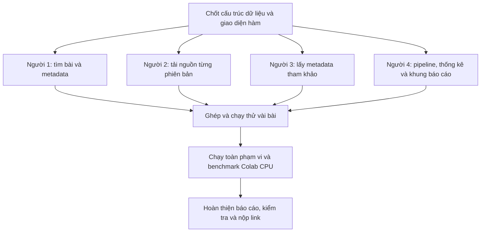

# Phân công Milestone 1 cho nhóm 4 người

Ngày lập: 11/10/2026.

Căn cứ: [Kế hoạch Milestone 1](./KE_HOACH_MILESTONE_1.md) và [đề bài đầy đủ](../../ARXIV_PROJECT_FULL.md).

## Các lựa chọn nhóm đã xác nhận

- Giữ tên phân công **Người 1, Người 2, Người 3, Người 4**.
- **Chưa nhận khoảng mã bài chính thức** từ thầy/trợ giảng. Dùng BERT/RoBERTa để phát triển và kiểm tra, không xem đó là phạm vi nộp bài.
- Phát triển bằng **Jupyter Notebook trên máy**, benchmark cuối trên **Google Colab CPU**.
- Báo cáo nộp bằng **tiếng Anh**. Kế hoạch và phân công này viết tiếng Việt để nhóm dễ trao đổi; phần phương pháp và nhận xét mỗi thành viên bàn giao cho báo cáo phải viết tiếng Anh.
- Các schema, tên hàm, chính sách file dưới đây là quy ước kỹ thuật đề xuất cho nhóm, không phải yêu cầu đặt tên bắt buộc của thầy. Có thể bắt đầu theo bản này; nếu đổi phải cập nhật đồng bộ trước khi ghép.
- Phiên bản Python cụ thể và phiên bản thư viện sẽ được ghi lại sau khi chạy thành công mẫu trên máy và Colab; tài liệu này chưa khẳng định đã kiểm tra tương thích môi trường.

## Toàn bộ quy trình Milestone 1 theo 4 bước chính

Có thể gom Milestone 1 thành **4 bước chính** dưới đây để dễ triển khai. Mỗi bước có đầu vào, xử lý và đầu ra rõ ràng. Đây là cách nhóm tổ chức công việc; không phải khẳng định đề chỉ có đúng bốn mục.

### Bước 1 — Tìm bài và lấy thông tin bài

**Nhận vào:** khoảng mã arXiv thầy giao. Nhóm chưa nhận nên chưa biết định dạng thông báo cụ thể. Khi chạy thử, có thể đưa vào danh sách mã:

```python
["1810.04805", "1907.11692"]
```

Đó là BERT và RoBERTa, chỉ dùng minh họa, không phải danh sách bài nộp.

**Làm gì:**

- Tìm những bài thuộc phạm vi được giao.
- Lấy tên bài, danh sách tác giả, ngày gửi, ngày sửa và nơi xuất bản nếu có.
- Xác định **tất cả phiên bản** của từng bài.

**Làm bằng cách nào:** viết Python trong notebook, chọn **arXiv API hoặc metadata Kaggle** để tìm/lọc bài. Nếu dữ liệu Kaggle thiếu thông tin cần thiết, bổ sung từ arXiv. Không bắt buộc triển khai cả hai phương án; kế hoạch ban đầu chọn arXiv API.

**Trả ra hai thứ:**

Một là **danh sách công việc cần tải**, dùng trong chương trình:

```python
[
    {"arxiv_id": "1810.04805", "versions": [1, 2]},
    {"arxiv_id": "1907.11692", "versions": [1]}
]
```

Danh sách này minh họa riêng mã bài và phiên bản. Khi bàn giao code, dùng PaperRecord đầy đủ có thêm trường metadata theo mục 2.3.

Hai là **metadata.json của mỗi bài**, ví dụ:

```json
{
  "arxiv_id": "1810.04805",
  "title": "BERT: Pre-training of Deep Bidirectional Transformers for Language Understanding",
  "authors": [
    "Jacob Devlin",
    "Ming-Wei Chang",
    "Kenton Lee",
    "Kristina Toutanova"
  ],
  "submission_date": "2018-10-11",
  "revised_dates": ["2019-05-24"],
  "venue": null
}
```

**Ai làm:** Người 1 lấy dữ liệu; Người 4 điều phối việc lưu metadata.json. Pipeline có thể thêm arxiv_id từ PaperRecord vào file như ví dụ trên.

### Bước 2 — Tải nguồn của tất cả phiên bản

**Nhận vào:** mã bài, số phiên bản và thư mục lưu từ bước 1.

```python
arxiv_id = "1810.04805"
version = 2
folder = "data/1810-04805/sources/v2/"
```

**Làm gì:**

- Tải nguồn tương ứng với `1810.04805v2`.
- Nhận diện định dạng gói tải và giải nén nếu cần.
- Giữ file văn bản nguồn như `.tex`, `.bib`, `.bbl`, `.sty` và các file văn bản liên quan.
- Bỏ ảnh nhị phân để tiết kiệm dung lượng, **giữ nguyên lệnh LaTeX chèn hình/bảng**.
- Lặp lại cho mọi phiên bản của mọi bài.

**Làm bằng cách nào:** Python dùng requests hoặc urllib để tải; tarfile, gzip và pathlib để xử lý, lưu file. Cần chờ giữa các yêu cầu, xử lý lỗi và giải nén an toàn.

**Trả ra:** các thư mục nguồn riêng biệt:

```text
data/1810-04805/sources/
├── v1/
│   └── các file nguồn của phiên bản 1
└── v2/
    └── các file nguồn của phiên bản 2
```

Kèm bản ghi trạng thái chứa mã bài, phiên bản, thành công/không có TeX/thất bại, số file giữ lại, dung lượng và thời gian. Trong giao diện hàm, Người 2 trả các trường tại mục 2.4; Người 4 gắn mã bài và phiên bản từ input vào manifest.

Nếu phiên bản chỉ có PDF, không có nguồn TeX thì **ghi nhận phiên bản không có TeX và giữ bản ghi rỗng**. Nếu lỗi mạng thì ghi lỗi để thử lại, không coi đó là “không có TeX”.

**Ai làm:** Người 2.

### Bước 3 — Lấy thông tin các tài liệu được tham khảo

**Nhận vào:** mã bài chính từ bước 1, ví dụ:

```python
"1907.11692"
```

Nghĩa là đang hỏi: **“RoBERTa tham khảo những bài nào?”** Bước này không cần chờ tải nguồn xong, nên có thể chạy song song với bước 2.

**Làm gì:**

- Hỏi Semantic Scholar lấy danh sách tham khảo.
- Lấy tên bài, tác giả, mã arXiv và mã Semantic Scholar của từng tài liệu.
- Giữ các mục có mã arXiv theo cấu trúc đề gợi ý.
- Bổ sung ngày gửi từ arXiv nếu cần; không nhầm ngày xuất bản với ngày gửi.

**Làm bằng cách nào:** Python dùng requests gọi Semantic Scholar API rồi xử lý phản hồi JSON. Có thể dùng API batch để hỏi nhiều bài trong một yêu cầu; vẫn phải xử lý giới hạn truy cập.

**Trả ra:** **references.json cho mỗi bài chính**, có dạng:

```json
{
  "1810-04805": {
    "title": "BERT: Pre-training of Deep Bidirectional Transformers for Language Understanding",
    "authors": [
      "J. Devlin",
      "Ming-Wei Chang",
      "Kenton Lee",
      "K. Toutanova"
    ],
    "submission_date": "2018-10-11",
    "semantic_scholar_id": "df2b0e26d0599ce3e70df8a9da02e51594e0e992"
  }
}
```

Đọc ví dụ là: **RoBERTa có tham khảo BERT, và đây là thông tin của BERT.** File đầy đủ chứa nhiều mục, không chỉ một mục này.

Kèm thống kê: tổng tham khảo nhận được, bao nhiêu mục có mã arXiv, bao nhiêu mục thiếu thông tin và lỗi truy vấn. Không cần tải toàn bộ nguồn của các bài được tham khảo nếu chúng không thuộc phạm vi bài chính được giao.

**Ai làm:** Người 3.

### Bước 4 — Ghép, kiểm tra, thống kê và báo cáo

**Nhận vào:** kết quả của ba bước trước:

```text
Danh sách bài và phiên bản
+ metadata.json
+ các thư mục nguồn
+ references.json
+ nhật ký và số đo lúc chạy
```

**Làm gì:**

- Ghép các phần thành chương trình chạy từ đầu đến cuối.
- Kiểm tra đủ bài, đủ phiên bản, file đọc được và trường dữ liệu đúng.
- Ghi rõ phần thành công, không có TeX, thiếu dữ liệu hoặc lỗi.
- Thống kê số bài, tỷ lệ thành công, số tham khảo và dung lượng trước/sau bỏ ảnh trên cùng cơ sở đo.
- Đo thời gian, RAM, dung lượng đĩa của toàn hệ thống trên **Colab CPU**.
- Viết báo cáo **tiếng Anh** bằng Jupyter Book, tạo bảng và biểu đồ khi biên dịch sách.

**Làm bằng cách nào:**

- Jupyter Notebook gọi các module của Người 1–3.
- pandas và matplotlib tổng hợp, vẽ bảng/biểu đồ.
- Công cụ đo thời gian/RAM ghi số đo **ngay trong lúc chạy**, không đợi chạy xong mới đo.
- Jupyter Book đưa báo cáo lên GitHub Pages. Báo cáo đọc kết quả đã lưu để sinh bảng/biểu đồ, không phải cào lại toàn bộ mỗi lần build.

**Trả ra:**

- Kho dữ liệu đã thu thập, giữ lại cho Milestone 2–3.
- Repository code công khai, có requirements.txt và README hướng dẫn chạy.
- Website báo cáo Jupyter Book ở repository riêng.
- **Nộp Moodle hai link: code và báo cáo. Milestone 1 chưa nộp corpus.**

**Ai làm:** Người 4 điều phối; Người 1–3 viết phần phương pháp và nhận xét của mình bằng tiếng Anh.

### Sơ đồ 4 bước và cách đọc dữ liệu

```text
                 1. Tìm bài + metadata
                         |
              +----------+----------+
              |                     |
              v                     v
     2. Tải nguồn mọi bản    3. Lấy metadata tham khảo
              |                     |
              +----------+----------+
                         |
                         v
            4. Kiểm tra + đo + báo cáo
```

**Phân biệt quan trọng:** metadata.json nói về **chính bài đang thu thập**; references.json nói về **những bài mà nó tham khảo**; thư mục sources chứa **nội dung nguồn của nó**. Phần phân công chi tiết bên dưới quy định rõ file mỗi người sở hữu, giao diện hàm và cách phát triển song song bằng dữ liệu mẫu.

## 1. Cách chia để làm cùng lúc

Chia theo thành phần của hệ thống, không chia mỗi người một số bài báo. Mỗi người viết một phần dùng được cho toàn bộ phạm vi bài được giao.

| Thành viên | Phụ trách chính | Hiểu đơn giản | Đầu ra chính |
|---|---|---|---|
| Người 1 | Tìm bài và metadata | Biết phải tải những bài nào, những phiên bản nào | Danh sách bài, phiên bản và metadata.json |
| Người 2 | Tải và xử lý nguồn | Lấy văn bản của từng phiên bản về máy | Thư mục nguồn và trạng thái tải |
| Người 3 | Metadata tài liệu tham khảo | Biết mỗi bài tham khảo những bài nào | references.json và trạng thái truy vấn |
| Người 4 | Điều phối, thống kê và báo cáo | Ghép các phần, đo kết quả và trình bày | Notebook chính, benchmark, Jupyter Book |

**Mọi người có thể bắt đầu cùng lúc sau khi chốt giao diện ở mục 2.** Người 2 và 3 dùng mã bài mẫu thay vì chờ người 1. Người 4 dùng dữ liệu giả lập để xây pipeline và báo cáo trước. Lần chạy toàn bộ và báo cáo số liệu thật phải chờ các thành phần ghép xong; đây là phụ thuộc tự nhiên, không thể coi mọi việc độc lập hoàn toàn.

Sơ đồ phối hợp:



## 2. Chốt trước để không phải chờ nhau

Đây là quy ước triển khai nhóm đề xuất, không phải tên hàm bắt buộc trong đề.

### 2.1. Một lần thống nhất ngắn trước khi chia việc

- [ ] Thay Người 1–4 bằng tên thành viên.
- [ ] Chốt phiên bản Python chung và cách mở notebook từ thư mục gốc repository.
- [ ] Chốt phạm vi bài chính thức khi nhận được từ trợ giảng; chưa có thì dùng BERT/RoBERTa để phát triển.
- [ ] Thống nhất schema và giao diện dưới đây; thay đổi sau đó phải báo cả nhóm.
- [ ] Tạo repository code chung và repository Jupyter Book riêng.

### 2.2. Quy tắc mã và đường dẫn

- Mã arXiv trong dữ liệu luôn giữ nguyên: `1810.04805`, `hep-th/9901001`.
- Thư mục bài: thay dấu chấm hoặc gạch chéo bằng dấu gạch ngang, ví dụ `1810-04805`, `hep-th-9901001`.
- Chỉ chấp nhận mã arXiv đã kiểm tra hợp lệ; không dùng chuỗi đầu vào tùy ý làm đường dẫn. Mã phiên bản được lưu riêng dưới dạng số nguyên, ví dụ `1`, `2`.
- `data_root` là thư mục gốc corpus; `paper_dir` là thư mục một bài; `version_dir` là thư mục một phiên bản.
- Người 4 tạo đường dẫn và truyền đúng thư mục cho hàm người 2–3, tránh mỗi người tự ghép một kiểu.
- Giữ cách đặt tên thư mục nhất quán toàn nhóm. Mã tài liệu tham khảo kiểu cũ vẫn giữ nguyên trong khóa JSON theo lưu ý đề, dù tên thư mục được ánh xạ an toàn.

```text
data/
├── manifest.json
└── 1810-04805/
    ├── metadata.json
    ├── references.json
    └── sources/
        ├── v1/
        └── v2/
```

### 2.3. Dữ liệu người 1 bàn giao

Một `PaperRecord` là dictionary có cấu trúc sau. Đây là cấu trúc trao đổi trong code, không nhất thiết phải xuất nguyên vẹn thành metadata.json.

```python
{
    "arxiv_id": "1810.04805",
    "versions": [1, 2],
    "metadata": {
        "title": "BERT: Pre-training of Deep Bidirectional Transformers for Language Understanding",
        "authors": ["Jacob Devlin", "Ming-Wei Chang", "Kenton Lee", "Kristina Toutanova"],
        "submission_date": "2018-10-11",
        "revised_dates": ["2019-05-24"],
        "venue": None
    }
}
```

- `versions` phải xác minh từ dữ liệu nguồn, không hardcode theo bài ví dụ.
- Ngày dùng ISO. Không có venue thì để null; không đoán.
- Người 1 cung cấp cả hàm lấy ngày gửi của một danh sách mã, để người 3 bổ sung ngày tham khảo mà không viết lại truy vấn arXiv.

### 2.4. Trạng thái chung để người 4 tổng hợp

Kết quả tải nguồn trả về dictionary với các trường thống nhất:

```python
{
    "status": "success",  # success | no_tex | failed
    "source_bytes_before": 0,  # tổng byte các file chưa nén trước lọc; null nếu chưa đo được
    "source_bytes_after": 0,   # tổng byte văn bản giữ lại, chưa nén
    "archive_bytes": 0,        # kích thước gói tải nén, đo riêng
    "file_count": 0,
    "elapsed_seconds": 0.0,
    "attempts": 1,
    "error": None
}
```

Các số 0 ở trên minh họa kiểu dữ liệu, không phải kết quả chạy thật. `no_tex` chỉ dùng khi đã xác minh nguồn không có TeX; lỗi mạng là `failed`.

Kết quả lấy tham khảo trả về:

```python
{
    "status": "success",  # success | partial | not_found | failed
    "references": {},     # dictionary sẽ ghi thành references.json
    "total_references": 0,
    "kept_references": 0,
    "missing_submission_dates": 0,
    "elapsed_seconds": 0.0,
    "attempts": 1,
    "error": None
}
```

- `partial`: lấy được một phần hoặc còn thiếu trường yêu cầu; phải mô tả phần thiếu trong error/log.
- `not_found`: dịch vụ chưa tìm thấy bài; không biến thành thành công với danh sách rỗng.
- Thành công với 0 tham khảo chỉ khi dịch vụ xác nhận danh sách rỗng hợp lệ.
- Nếu thất bại, số tổng tham khảo chưa biết để null, không ghi 0 làm sai thống kê.

### 2.5. Giao diện hàm mỗi người giữ ổn định

| Người | Hàm bàn giao | Đầu vào | Đầu ra |
|---|---|---|---|
| 1 | `discover_papers(scope: dict) -> list[dict]` | Cấu hình phạm vi trợ giảng giao | Danh sách PaperRecord |
| 1 | `fetch_submission_dates(ids: list[str]) -> dict[str, str \| None]` | Mã arXiv gốc | Mã → ngày ISO hoặc None |
| 2 | `download_version(arxiv_id: str, version: int, version_dir: Path) -> dict` | Một bài, một phiên bản, đường dẫn lưu | Trạng thái tải theo mục 2.4; ghi nguồn vào version_dir |
| 3 | `collect_references(arxiv_id: str, paper_dir: Path, date_lookup: Callable) -> dict` | Mã bài, thư mục bài, hàm tra ngày | Kết quả tham khảo theo mục 2.4; ghi references.json khi có dữ liệu |
| 4 | `run_pipeline(scope: dict, data_root: Path) -> dict` | Phạm vi, thư mục corpus | Manifest cập nhật và tổng kết chạy |

`Path` từ pathlib, `Callable` từ typing. `date_lookup` có giao diện giống `fetch_submission_dates`. Người 3 truyền hàm giả lập trả ngày mẫu trong lúc người 1 chưa xong; khi ghép, người 4 truyền hàm thật. Retry HTTP cục bộ thuộc người sở hữu API; người 4 chỉ quyết định chạy tiếp những tác vụ còn thiếu, tránh retry lồng nhau.

`scope` khi phát triển có thể là `{"mode": "ids", "ids": ["1810.04805", "1907.11692"]}`. Sau khi có phân công chính thức, người 1 và 4 chốt thêm cách biểu diễn phạm vi đúng thông báo, không tự suy luận một khoảng mã còn chưa nhận.

### 2.6. Giải thích input/output theo từng người

**Input** là thứ người đó nhận để bắt đầu xử lý. **Output** gồm hai loại: giá trị hàm trả về cho phần code khác và file được ghi ra đĩa. Hai loại này phải phân biệt, vì trả một dictionary trong bộ nhớ chưa có nghĩa là file JSON đã được lưu.

#### Người 1: nhận phạm vi, trả danh sách bài và metadata

**Input chính:** dictionary `scope` do người 4/notebook chính truyền vào.

```json
{
  "mode": "ids",
  "ids": ["1810.04805", "1907.11692"]
}
```

Đây là input phát triển. Khi thầy giao khoảng mã, người 1 bổ sung bộ lọc theo chính phạm vi đó; không tự biến hai mã mẫu thành bài nộp. Input phải chứa mã bài gốc, không phải tên thư mục và không gắn hậu tố phiên bản.

**Output chính:** `discover_papers` trả `list[dict]`, mỗi phần tử là một PaperRecord của mục 2.3:

- `arxiv_id`: dùng để gọi arXiv và Semantic Scholar.
- `versions`: các phiên bản đã xác minh; người 4 lặp qua danh sách này để gọi người 2.
- `metadata`: thông tin của chính bài đó, người 4 lưu thành metadata.json.

Ví dụ giản lược luồng dùng output:

```text
Người 1 trả bài 1810.04805 với versions = [1, 2]
    → Người 4 ghi metadata của bài
    → Người 4 gọi Người 2 hai lần: v1 và v2
    → Người 4 gọi Người 3 cho bài 1810.04805
```

**Input/output phụ phục vụ người 3:**

```python
# Input của fetch_submission_dates
["1706.03762", "1810.04805"]

# Output tương ứng, dùng ngày ISO thống nhất
{
    "1706.03762": "2017-06-12",
    "1810.04805": "2018-10-11"
}
```

Mọi mã được yêu cầu đều có khóa trong output. Nếu thiếu ngày thì giá trị None; lỗi dịch vụ được ghi rõ để người 3 đánh dấu partial. Không thay ngày thiếu bằng ngày hiện tại hoặc ngày xuất bản.

**File người 1 bàn giao:** discover.py, notebook discovery và nội dung phương pháp bằng tiếng Anh. `metadata.json` do pipeline người 4 ghi từ output người 1, tránh hai người cùng ghi một file.

**Khi lỗi:** input sai phải báo lỗi cấu hình; discovery bị gián đoạn phải báo lỗi và lưu thông tin cần tiếp tục, không trả danh sách thiếu mà tuyên bố đã quét đủ phạm vi. Danh sách rỗng chỉ được dùng khi đã truy vấn thành công và thực sự không có bài phù hợp. Nếu chưa xác minh được lịch sử phiên bản của một bài, không đoán `[1]`; ghi bài chưa hoàn tất vào log để chạy lại.

#### Người 2: nhận một bài + một phiên bản, trả nguồn và trạng thái

**Input:**

```python
arxiv_id = "1810.04805"
version = 2
version_dir = Path("data/1810-04805/sources/v2")
```

- `arxiv_id`: mã gốc để xây địa chỉ tải.
- `version`: phiên bản chính xác cần tải; ví dụ trên tải `1810.04805v2`.
- `version_dir`: nơi lưu nguồn; người 4 truyền vào, người 2 không tự đổi cấu trúc thư mục.

**Output file:** nguồn văn bản của phiên bản được lưu trong version_dir, giữ cấu trúc thư mục con khi cần. Tên file phụ thuộc nguồn thật, không mặc định bài nào cũng có main.tex hay refs.bib.

```text
data/1810-04805/sources/v2/
    các file .tex, .bbl, .bib, .sty... nếu nguồn có
```

**Output hàm:** dictionary trạng thái ở mục 2.4. Người 4 bổ sung mã bài/phiên bản vào manifest dựa trên chính input lần gọi, không suy ra từ tên file.

| Trường output | Ý nghĩa và cách dùng |
|---|---|
| status | success: nguồn đã kiểm tra; no_tex: nguồn thực sự không có TeX; failed: chưa xử lý được |
| source_bytes_before | Tổng dung lượng file chưa nén trước lọc, để tính ảnh hưởng bỏ ảnh |
| source_bytes_after | Dung lượng văn bản giữ lại chưa nén |
| archive_bytes | Dung lượng gói tải, tách khỏi hai chỉ số trên |
| file_count | Số file văn bản giữ lại |
| elapsed_seconds | Thời gian lần xử lý này, gồm chờ/retry trong hàm |
| attempts | Số lượt yêu cầu tải đã thử; dùng 0 nếu dùng kết quả hợp lệ sẵn có |
| error | null nếu thành công; mô tả lỗi hoặc lý do no_tex nếu có |

**Ví dụ số đo thật đã có:** BERT v2 có gói tải 316748 byte, giữ 24 file văn bản tổng 173865 byte. Chưa có số đo tổng file chưa nén trước lọc và thời gian trong ví dụ cũ thì phải để null cho hai trường đó, không lấy 316748 làm source_bytes_before.

**Khi lỗi:** không tạo nguồn dở dang trông như hoàn chỉnh. Tải/giải nén vào vùng tạm, xác minh rồi mới đánh dấu hoàn tất. Với no_tex, giữ bản ghi và thư mục phiên bản không có nguồn TeX. Với failed, giữ log để thử lại; không xóa dữ liệu hợp lệ của lần trước.

**Ai dùng output:** người 4 tổng hợp trạng thái/số đo; Milestone 2 dùng trực tiếp các file nguồn.

#### Người 3: nhận mã bài và hàm tra ngày, trả danh sách tham khảo

**Input:**

```python
arxiv_id = "1907.11692"
paper_dir = Path("data/1907-11692")
date_lookup = fetch_submission_dates
```

- `arxiv_id`: bài đang hỏi danh sách tham khảo, ở đây là RoBERTa.
- `paper_dir`: nơi lưu references.json của RoBERTa.
- `date_lookup`: một hàm nhận danh sách mã và trả ngày gửi như mô tả cho người 1. Trước khi ghép, dùng hàm giả lập cùng giao diện để kiểm tra.

**Không cần input là nguồn LaTeX của người 2.** Người 3 lấy thông tin bằng mã bài từ dịch vụ bên ngoài, vì vậy có thể làm song song với người 2.

**Output file:** `data/1907-11692/references.json`, một dictionary có khóa là mã bài được tham khảo. Ví dụ một mục thật được rút gọn để đọc:

```json
{
  "1810-04805": {
    "title": "BERT: Pre-training of Deep Bidirectional Transformers for Language Understanding",
    "authors": ["J. Devlin", "Ming-Wei Chang", "Kenton Lee", "K. Toutanova"],
    "submission_date": "2018-10-11",
    "semantic_scholar_id": "df2b0e26d0599ce3e70df8a9da02e51594e0e992",
    "publication_date": null
  }
}
```

Tác giả ở đây giữ cách viết dịch vụ trả về, không tự mở rộng tên viết tắt bằng suy đoán. File thật chứa tất cả mục có mã arXiv lấy được, không chỉ một mục ví dụ. `publication_date` là trường thêm tùy chọn, không thay cho submission_date. Mã kiểu mới dùng khóa dấu gạch ngang; mã kiểu cũ giữ nguyên định danh trong khóa JSON.

**Output hàm:** dictionary ở mục 2.4, trong đó `references` chứa đúng dữ liệu đã ghi thành file; các chỉ số còn lại giúp người 4 thống kê chất lượng truy vấn.

Ví dụ lần truy vấn mẫu RoBERTa thành công:

```text
status = success
total_references = 68
kept_references = 40
missing_submission_dates = 0
```

Các số trên là kết quả đã quan sát ở ví dụ, không phải số cố định mà code phải luôn trả.

**Khi lỗi:** nếu API failed/not_found và không lấy được dữ liệu, không ghi `{}` đè lên references.json hợp lệ. Nếu một phần tham khảo thiếu ngày, có thể ghi dữ liệu hiện có nhưng trả partial và số mục thiếu. Không có tham khảo thật là khác với chưa truy vấn được. Nếu có key, đọc từ môi trường, không đưa vào output/log.

**Ai dùng output:** người 4 lập bảng và kiểm tra; Milestone 3 đối chiếu các mục này với BibTeX trích xuất ở Milestone 2.

#### Người 4: nhận ba module, ghép corpus và trả kết quả chung

**Input chạy chính:**

```python
scope = {"mode": "ids", "ids": ["1810.04805", "1907.11692"]}
data_root = Path("data")
```

Ngoài ra người 4 nhận các hàm đúng giao diện từ người 1–3; cấu hình môi trường; kết quả/log lần chạy trước nếu cần tiếp tục. API key là cấu hình bí mật tùy chọn, không phải dữ liệu bàn giao qua Git.

**Cách ghép input/output:**

1. Gọi discover_papers(scope) lấy danh sách PaperRecord.
2. Với mỗi PaperRecord, tạo paper_dir và ghi metadata.json từ trường metadata.
3. Lặp versions, gọi download_version cho mỗi phiên bản và lưu kết quả trạng thái vào manifest.
4. Gọi collect_references một lần cho bài, truyền fetch_submission_dates làm date_lookup.
5. Từ trạng thái, dữ liệu và số đo, tạo bảng chất lượng dữ liệu/hiệu năng.

**Output hàm run_pipeline:** quy ước trả một dictionary:

```python
{
    "run_id": "ma-lan-chay",
    "manifest_path": "data/manifest.json",
    "metrics_path": "metrics/run_summary.json",
    "summary": {
        "papers_discovered": 2,
        "versions_expected": 3,
        "versions_success": 3,
        "versions_no_tex": 0,
        "versions_failed": 0,
        "reference_jobs_success": 2,
        "reference_jobs_partial": 0,
        "reference_jobs_failed": 0,
        "reference_jobs_not_found": 0
    }
}
```

Đây là ví dụ để thống nhất cấu trúc, không phải tuyên bố pipeline đã xây và chạy. Số bài được giao chưa biết ở lần thử thì ghi trong metadata lần chạy là chưa có phạm vi chính thức; không lấy papers_discovered làm bằng chứng quét đủ.

**Output file và sản phẩm:**

| Đầu ra | Nội dung | Ai dùng? |
|---|---|---|
| data/manifest.json | Mã bài, phiên bản, trạng thái từng tác vụ, đường dẫn output, lý do lỗi, thông tin lần chạy | Cả nhóm kiểm tra và chạy tiếp |
| data/... | Corpus ghép từ metadata, nguồn và tham khảo | Milestone 2–3 |
| metrics/run_summary.json | Phạm vi thực chạy, thời gian tổng, RAM/đĩa, trạng thái cache và các thống kê tổng hợp | Notebook phân tích và báo cáo |
| Notebook chính | Cấu hình, điều khiển chạy, xem dữ liệu và thống kê | Cả nhóm phát triển trên Jupyter |
| Jupyter Book tiếng Anh | Phương pháp, kết quả thật, bảng/biểu đồ sinh khi build và giới hạn | Giảng viên đọc/chấm |
| README + requirements.txt | Cài đặt và tái lập môi trường/chạy code | Người khác chạy lại |

**Khi lỗi hoặc còn thiếu:** báo cáo đúng số tác vụ failed/partial/not_found; trạng thái running của lần bị ngắt phải được kiểm tra lại trước khi chạy tiếp. Output pipeline có thể tồn tại dù còn lỗi, nhưng không được diễn giải thành toàn bộ corpus đã hoàn chỉnh.

### 2.7. Những quy ước bổ sung để ghép không bị lệch

- File JSON dùng UTF-8, số liệu là kiểu số thật; không lưu số byte hoặc số giây thành chuỗi có đơn vị.
- Ngày gửi/ngày sửa dùng `YYYY-MM-DD` sau khi thống nhất quy đổi từ timestamp UTC của arXiv; thời điểm truy vấn/log dùng timestamp có múi giờ. Nếu cần giữ timestamp gốc, lưu trường riêng.
- Dữ liệu chưa biết dùng null; danh sách rỗng/dictionary rỗng chỉ diễn tả kết quả đã xác minh hoặc tình trạng được ghi rõ trong status. Không đồng nhất null với 0.
- Tham khảo trùng mã trong một phản hồi được gộp theo mã; không chọn ngẫu nhiên khi metadata mâu thuẫn, ghi nhận xung đột. Đây là gộp bản ghi API trùng, không thay phần dedup BibTeX của Milestone 2.
- Dùng đường dẫn cấu hình và pathlib, không hardcode ổ đĩa máy cá nhân để Colab dùng lại được.
- Người 4 sở hữu manifest và file metrics chung; người 1–3 chỉ trả số đo/trạng thái, không cùng ghi chồng lên file chung.
- File đầu ra quan trọng ghi tạm rồi thay thế sau khi ghi thành công; tác vụ lỗi không làm mất kết quả hợp lệ cũ.
- Nếu chạy lại dùng cache, manifest phải ghi rõ; không cộng thời gian cache vào benchmark tải mới rồi so sánh như cùng điều kiện.
- Phát triển ban đầu chạy tuần tự qua notebook; làm việc song song giữa thành viên không có nghĩa được gọi API không giới hạn cùng lúc.
- Cả ba người 1–3 gửi phần phương pháp và nhận xét bằng tiếng Anh, kèm nguồn/tài liệu đã dùng; người 4 biên tập chung.

### 2.8. Các thông tin còn chờ và trách nhiệm cập nhật

| Thông tin | Hiện trạng | Cách cập nhật |
|---|---|---|
| Khoảng mã bài chính thức | Chưa nhận | Khi thầy gửi, người 1 và 4 cập nhật scope; giữ nguyên module tải/tham khảo nếu giao diện không đổi |
| Deadline | Chưa được cung cấp | Nhóm bổ sung từ Moodle/thông báo; kế hoạch không tự đặt ngày nộp |
| Repo code và repo Book | Chưa ghi URL trong tài liệu | Người 4 bổ sung sau khi nhóm tạo/chọn repository |
| API key Semantic Scholar | Chưa yêu cầu phải có; ví dụ batch đã chạy không key | Nếu có thì lưu qua biến môi trường/Secrets; thiếu key vẫn phát triển được với phản hồi mẫu và truy cập công khai khi dịch vụ cho phép |
| Phiên bản Python/thư viện | Chưa khóa phiên bản đã kiểm tra | Người 4 ghi sau lần chạy mẫu chung trên máy và Colab |

Các mục này không ngăn nhóm phát triển độc lập trên mẫu BERT/RoBERTa. Phạm vi chính thức phải có trước khi chạy corpus nộp bài; các thông tin khác được bổ sung khi có, không bịa giá trị để lấp chỗ trống.

## 3. Người 1 — Tìm bài và lấy metadata

**Bạn này trả lời:** “Nhóm phải xử lý những bài nào? Mỗi bài có những phiên bản nào? Thông tin bài là gì?”

**Sở hữu:** `src/crawling/discover.py`, `src/notebooks/01_discovery.ipynb`, kiểm tra riêng cho discovery.

**Dùng gì:** Python, arXiv API, có thể dùng thư viện arxiv, json. Đối chiếu lịch sử phiên bản trên arXiv. Không phải triển khai cả Kaggle và OAI-PMH.

### Task

- [ ] Chạy truy vấn với danh sách BERT/RoBERTa mẫu, lấy đúng bài và metadata.
- [ ] Xây `discover_papers`, xử lý kết quả nhiều trang và lọc đúng phạm vi khi có đầu vào chính thức.
- [ ] Xác minh và trả mọi phiên bản; phân biệt một bài nhiều phiên bản với nhiều bài khác nhau.
- [ ] Tạo metadata đủ title, authors, submission_date, revised_dates và venue nếu có.
- [ ] Xây `fetch_submission_dates` để người 3 gọi lại; thiếu dữ liệu trả None, không đoán ngày.
- [ ] Đặt nhịp truy vấn phù hợp, retry có giới hạn, ghi lỗi rõ; không để nhiều tác vụ arXiv chạy song song vượt nhịp dịch vụ.
- [ ] Khi pipeline chạy, lưu metadata.json vào thư mục bài qua cơ chế thống nhất với người 4; phần ghi file này do người 4 điều phối từ PaperRecord.
- [ ] Viết phần giải thích discovery/metadata cho báo cáo, gửi nội dung cho người 4.

### Làm độc lập bằng cách nào?

Chỉ cần danh sách mã mẫu và arXiv. Không cần nguồn LaTeX của người 2 hoặc tham khảo của người 3.

### Đạt khi nào?

- Notebook hiển thị bảng mã bài, tên bài, số phiên bản và ngày.
- BERT/RoBERTa trả đúng lịch sử ở thời điểm kiểm tra; không hardcode các kết quả đó trong hàm.
- Mã kiểu cũ được giữ nguyên; lỗi truy vấn không bị coi là bài không tồn tại.
- Người 2 có thể dùng danh sách phiên bản, người 3 gọi được hàm tra ngày, người 4 gọi discovery mà không sửa code nội bộ.

## 4. Người 2 — Tải nguồn và xử lý file

**Bạn này trả lời:** “Làm sao tải đủ nguồn từng phiên bản, giữ đúng văn bản và không mất bài?”

**Sở hữu:** `src/crawling/download.py`, `src/notebooks/02_download.ipynb`, kiểm tra gói nguồn và đường dẫn.

**Dùng gì:** Python, requests/urllib, pathlib, tarfile, gzip.

### Task

- [ ] Xây `download_version` với đầu vào mã bài và số phiên bản.
- [ ] Tải theo mã có hậu tố phiên bản; lưu riêng từng phiên bản.
- [ ] Nhận diện tar/gzip, nguồn TeX đơn và trường hợp chỉ có PDF/Word; không chỉ dựa vào đuôi file.
- [ ] Giải nén an toàn: chặn đường dẫn thoát thư mục, đường dẫn tuyệt đối và liên kết nguy hiểm.
- [ ] Giữ file văn bản nguồn, kể cả thư mục con; bỏ ảnh nhị phân nhưng không sửa các lệnh hình/bảng trong LaTeX.
- [ ] Xác minh xong mới đánh dấu success; giữ trạng thái no_tex cho trường hợp thực sự không có TeX.
- [ ] Xử lý timeout/429/5xx bằng retry có giới hạn, tuân thủ nhịp dịch vụ; ghi số lần thử và lỗi.
- [ ] Đo thời gian, số file và dung lượng trước/sau lọc trên cùng cơ sở chưa nén; gói nén có số đo riêng.
- [ ] Dọn file tạm hoặc ghi rõ việc giữ gói gốc, tránh vượt đĩa Colab.
- [ ] Viết giải thích download, lựa chọn giữ/bỏ file và các trường hợp đặc biệt cho báo cáo.

### Làm độc lập bằng cách nào?

Dùng ba đầu vào cố định đã xác minh để thử: BERT v1, BERT v2 và RoBERTa v1. Không cần chờ discovery. Có thể đọc nguồn thật đã tải trong `milestone1_demo`, nhưng cần thử hàm tải mới ít nhất một lần để kiểm tra đường mạng.

### Đạt khi nào?

- Nhận đầu vào là tải được nguồn vào đúng version_dir, trả đúng trạng thái thống nhất.
- Nội dung văn bản không bị thay đổi; không nhầm v1/v2.
- Kiểm tra gói giả lập có ảnh, TeX đơn, PDF-only và đường dẫn nguy hiểm; hành vi đúng, không cần dùng API thật cho các kiểm tra này.
- Gọi lại không tạo dữ liệu trùng hoặc coi gói lỗi là nguồn hợp lệ.

## 5. Người 3 — Lấy metadata tài liệu tham khảo

**Bạn này trả lời:** “Mỗi bài trích dẫn những bài nào, thông tin của chúng là gì?”

**Sở hữu:** `src/crawling/references.py`, `src/notebooks/03_references.ipynb`, kiểm tra chuyển đổi phản hồi API.

**Dùng gì:** Python, requests, json, Semantic Scholar Academic Graph API; hàm tra ngày arXiv của người 1.

### Task

- [ ] Xây `collect_references`, tra bài theo mã arXiv và lấy danh sách tham khảo đầy đủ.
- [ ] Chọn endpoint phù hợp; xử lý phân trang nếu có. Có thể dùng batch chính thức, nhưng không coi batch là luôn tránh được giới hạn truy cập.
- [ ] Lấy tên bài, tác giả, externalIds, mã Semantic Scholar và các trường ngày cần thiết.
- [ ] Giữ mục có mã arXiv trong references.json; giữ mã kiểu cũ đúng nguyên dạng.
- [ ] Bổ sung submission_date bằng date_lookup. Ngày xuất bản là trường riêng, không dùng thay ngày gửi.
- [ ] Lưu JSON đúng kiểu; dữ liệu thiếu phải thể hiện bằng null và trạng thái partial, không bịa giá trị.
- [ ] Phân biệt 0 tham khảo thật, không có mã arXiv, dịch vụ không tìm thấy bài và lỗi truy vấn.
- [ ] Ghi tổng tham khảo, số giữ lại, số thiếu ngày, thời gian và lỗi để người 4 thống kê.
- [ ] Đọc API key từ môi trường nếu nhóm có; không commit key. Với 429, tuân thủ Retry-After/backoff và giới hạn retry.
- [ ] Viết giải thích quá trình, độ phủ dịch vụ và giới hạn tham khảo không phân biệt phiên bản cho báo cáo.

### Làm độc lập bằng cách nào?

Dùng mã BERT/RoBERTa và các phản hồi thật đã lưu trong `milestone1_demo`. Trước khi người 1 xong, dùng date_lookup giả lập để thử xử lý. Chỉ kết quả gọi bằng hàm thật mới dùng làm dữ liệu báo cáo chính thức.

### Đạt khi nào?

- Tạo được references.json theo schema và đọc lại thành công.
- Kiểm tra trường hợp tham khảo không có externalIds, tác giả rỗng, thiếu ngày, danh sách rỗng và 429 bằng phản hồi giả lập.
- Báo rõ trường thiếu; không nhận thành công nếu thực tế chỉ có một trang của danh sách tham khảo.
- Ví dụ cũ có BERT 35 và RoBERTa 40 mục có mã arXiv là số đối chiếu của lần truy vấn trước; không hardcode thành kết quả bắt buộc vì dịch vụ có thể cập nhật.

## 6. Người 4 — Pipeline, thống kê, benchmark và Jupyter Book

**Bạn này trả lời:** “Làm sao chạy chung các phần, biết kết quả tốt đến đâu và báo cáo được?”

**Sở hữu:** `src/crawling/pipeline.py`, `src/crawling/metrics.py`, `src/notebooks/milestone1.ipynb`; cấu hình repository, README, requirements tổng và repository Jupyter Book.

**Dùng gì:** Python, Jupyter Notebook, pandas, matplotlib, psutil, logging, Jupyter Book, GitHub Pages, Google Colab CPU.

### Task làm ngay, không cần chờ ba người còn lại

- [ ] Tạo khung package, notebook chính, cấu hình đường dẫn và manifest theo mục 2.
- [ ] Viết ba hàm thay thế cho discovery/download/references, trả dữ liệu mẫu đúng schema; ghi rõ đây là giả lập.
- [ ] Xây pipeline gọi các hàm thay thế để kiểm tra thứ tự xử lý, ghi metadata.json và manifest.
- [ ] Làm chức năng bỏ qua phần đã xác minh, tiếp tục phần lỗi, không tải lại tất cả vô điều kiện.
- [ ] Tạo bảng thống kê theo trạng thái bài và phiên bản, định nghĩa rõ mẫu số của từng tỷ lệ.
- [ ] Xây bộ đo thời gian, RAM và đĩa; ghi cấu hình môi trường và điều kiện cache.
- [ ] Tạo khung Jupyter Book: mục tiêu, phương pháp, chất lượng dữ liệu, hiệu năng, giới hạn và tài liệu tham khảo.
- [ ] Dùng kết quả giả lập chỉ để kiểm tra build, gắn nhãn rõ; không trình bày như số liệu đã thu thập.
- [ ] Tạo README chạy code và quy tắc không commit corpus/key/log/output cào hàng loạt.

### Task sau khi các phần bàn giao

- [ ] Thay hàm giả lập bằng hàm thật, chạy thử vài bài từ kernel sạch.
- [ ] Ghép lỗi giao diện với chủ phần tương ứng; không tự viết lại các module người khác phụ trách.
- [ ] Chạy toàn phạm vi được giao, xác minh các trường hợp thiếu.
- [ ] Điều phối benchmark Colab CPU của toàn hệ thống: thời gian từ đầu đến cuối, RAM toàn tiến trình liên quan, đỉnh đĩa và dung lượng cuối.
- [ ] Thay số liệu giả lập bằng kết quả thật; sinh bảng/biểu đồ khi build sách.
- [ ] Ghép nội dung phương pháp do người 1–3 viết và hoàn thiện báo cáo chung.
- [ ] Kiểm tra hai link công khai và chuẩn bị nộp Moodle.

### Đạt khi nào?

- Notebook chính chạy đủ luồng, xử lý tác vụ lỗi/running chưa hoàn tất khi chạy lại.
- Không có số liệu giả lập lẫn trong báo cáo cuối.
- Jupyter Book build được từ kết quả đã lưu mà không cào toàn bộ mỗi lần build.
- Một thành viên khác làm theo README chạy được.

**Để cân bằng khối lượng:** người 4 sở hữu cấu hình, tích hợp và biên tập sách; người 1–3 phải tự viết nội dung phương pháp, kiểm tra số liệu phần mình và cùng chạy benchmark. Không dồn toàn bộ việc viết báo cáo cho người 4.

## 7. Kế hoạch chạy song song theo mốc

Không ấn định số ngày vì còn tùy thời gian nhóm và quy mô bài được giao. Dùng các mốc có kết quả kiểm tra rõ ràng:

| Mốc | Người 1 | Người 2 | Người 3 | Người 4 |
|---|---|---|---|---|
| A: chốt quy ước | Cùng chốt schema, phạm vi và giao diện hàm | Cùng chốt | Cùng chốt | Tạo khung chung |
| B: làm độc lập | Discovery và metadata mẫu | Tải nguồn mẫu | Tham khảo mẫu, date_lookup giả | Pipeline giả lập, bảng và khung sách |
| C: bàn giao | Hàm thật + giải thích sử dụng | Hàm thật + giải thích sử dụng | Hàm thật + giải thích sử dụng | Notebook ghép thử + danh sách lỗi |
| D: chạy thật | Kiểm tra phạm vi/metadata | Kiểm tra nguồn/phiên bản | Kiểm tra tham khảo/thiếu trường | Điều phối chạy và lưu số đo |
| E: báo cáo/nộp | Viết, rà soát phần mình | Viết, rà soát phần mình | Viết, rà soát phần mình | Tổng hợp, build, kiểm tra link |

Khi phát triển song song, các thành viên có thể chạy code cùng lúc nhưng các lời gọi đến cùng dịch vụ vẫn phải được phối hợp nhịp truy cập. Tránh cả người 1 và 3 cùng bắn truy vấn arXiv dồn dập, hoặc mọi người cùng chạy toàn corpus. Lần chạy tích hợp nên có một người điều phối.

## 8. Cách bàn giao và ghép code

- Mỗi người làm trên nhánh riêng; không sửa file do người khác sở hữu nếu chưa thống nhất.
- Người 4 khởi tạo `__init__.py`, README, requirements tổng và notebook chính. Người 1–3 gửi danh sách thư viện cần thêm để tránh sửa cùng file.
- Mỗi người có notebook riêng để thử, tránh cùng sửa một notebook gây xung đột.
- Khi bàn giao phải có: hàm đúng giao diện, cách gọi, đầu vào mẫu, đầu ra thực tế, trạng thái lỗi đã kiểm tra và nội dung giải thích cho báo cáo.
- Nếu cần đổi schema/hàm, thông báo rõ trước khi đổi; cập nhật cả dữ liệu giả lập của người 4.
- Người 4 ghép từng module rồi chạy thử; chủ module chịu trách nhiệm sửa lỗi phần mình.
- Các phản hồi API mẫu dùng trong kiểm tra nên nhỏ, có nguồn và chỉ giữ dữ liệu tối thiểu; không đưa toàn bộ corpus vào repository code.
- Với dữ liệu mẫu thật đã có trong milestone1_demo, dùng cục bộ để hiểu và đối chiếu. Không tự động đẩy cả thư mục đó lên repo nộp.

## 9. Checklist hoàn thành của cả nhóm

- [ ] Đúng phạm vi bài do trợ giảng giao, đủ mọi phiên bản được ghi nhận.
- [ ] Nguồn TeX/văn bản được lưu đúng; không có TeX và lỗi mạng được phân biệt.
- [ ] Metadata bài và tham khảo đúng kiểu, có thông tin nguồn thiếu rõ ràng.
- [ ] Có kiểm tra chạy lại/gián đoạn, không trùng hoặc mất dữ liệu.
- [ ] Có thống kê chất lượng dữ liệu và benchmark Colab CPU toàn pipeline.
- [ ] Các thành viên cùng đóng góp phần phương pháp và nhận xét kết quả vào báo cáo.
- [ ] Code công khai với README và requirements; lịch sử commit phản ánh tiến độ.
- [ ] Jupyter Book ở repository riêng, GitHub Pages truy cập được, bảng/biểu đồ sinh khi build.
- [ ] Nộp Moodle link code và link báo cáo đúng hạn; giữ corpus cho Milestone 2–3.

**Cách nhớ phân công:** người 1 tìm bài và ghi phiếu bài; người 2 tải nội dung; người 3 lấy phiếu các bài được tham khảo; người 4 ghép, đo và trình bày. Ba người đầu cùng chịu trách nhiệm nội dung báo cáo của phần mình.
